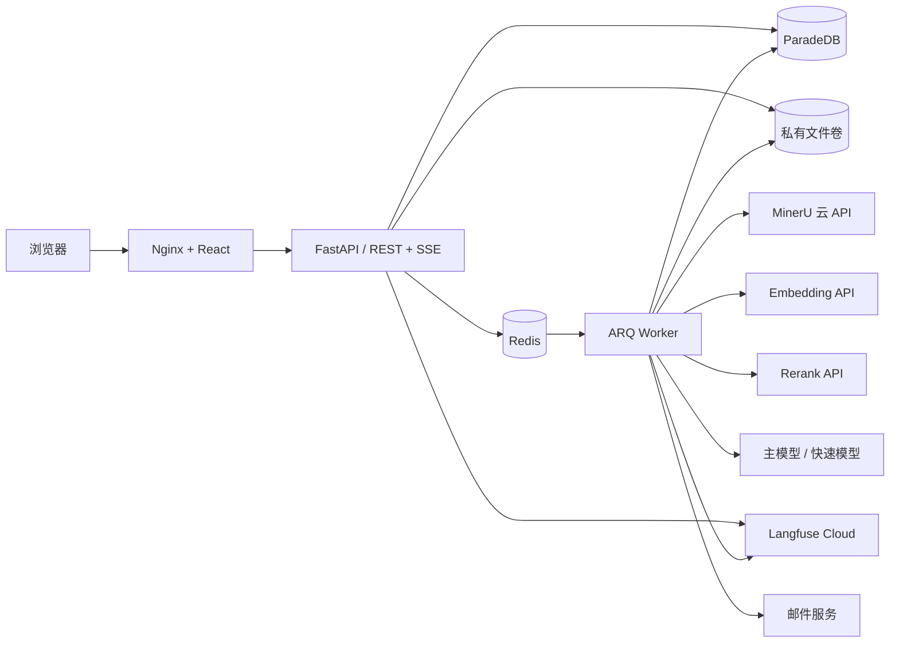
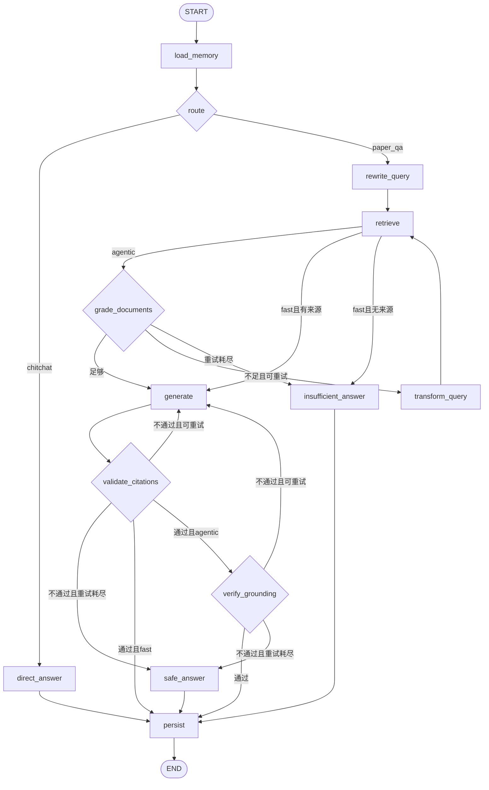

# PaperMind-RAG 实现计划

2026-10-31 用户要求先本地部署试用，再有序考虑上云。当前已复核本地五个服务健康与浏览器入口，先收集试用反馈；后续按 M6 质量 / 稳定性验证、部署演练、小范围正式上线的顺序推进，详见 [本地试用与上云顺序](docs/LOCAL_TRIAL.md)。本地服务可用不代表 M6 回答质量或公网部署已经验收。

当前状态（2026-10-31）：**M0–M5 及近期升级的前置功能验收已闭环，可进入 M6 回答质量与上线验收。** 当前切块 / 检索为 `academic-bge-v5 / paper-map-tools-v5`，Prompt 为 `m4-v6-node-context`，冻结集为 `m3-gold-v7`；问题、答案、证据及语料保持用户确认内容。

用户已确认“我已核对完暂无需要修改的地方”，确认覆盖 36 题及 5 项机制，原 v6 审核表完整归档。[审核与冻结记录](docs/M3_HUMAN_V7.md)、[当前实模收尾记录](docs/PRE_M6_LIVE_V7.md)、[M6 前置核查](docs/PRE_M6_AUDIT.md)。

当前生产混合重排 **Hit@8 = 0.8235（28/34）、MRR@8 = 0.5439，隔离泄漏为 0**，最终四方案报告见 [v7 评测](reports/m3-retrieval-v7-final.json)。已修复证据组预算及共享来源角色覆盖，门槛、融合配置与标签均未修改。上下文至少一项命中 31/34，全部标签覆盖 23/34，不能与回答质量混同。

宿主机直连及更新后的容器线路已恢复，两个配置模型的容器认证查询均为 200；API / Worker 已重建，网页及同源 API 正常。工具计划逐项校验、结构化反馈、有限超时 / 限流重试和内部重复上下文去重已实现。最后 IDEA 场景在有限退避后已通过，十类场景均有分批真实通过记录；未宣称一次最终全量实模运行连续通过全部十例。IDEA 本次耗时 285.9 秒（含限流等待），性能与持续稳定性在 M6 验收。

论文地图迁移为 `0009_paper_map`；2026-10-31 按用户要求新增 `0010_email_codes`，注册改为先发送 / 校验 6 位邮箱验证码，再创建已验证账户（10 分钟有效、60 秒重发间隔、最多 5 次错误），密码最低 8 字符。已有未验证账户支持登录后验证码验证，兼容旧验证链接，密码重置仍使用邮件链接。未重新解析用户论文。当前检索功能与升级方式见 [论文地图、三种工具](docs/PAPER_MAP_TOOLS.md)。M6 继续执行回答 Faithfulness、引用内容支持、负载、HTTPS、监控、真实邮件投递、备份恢复及正式部署验收。

当前仅保留 v7 评测材料及必要审核来源，旧版冗余已清理，见 [清理报告](reports/version-cleanup.json)。阶段说明：[M0](docs/M0.md)、[M1](docs/M1.md)、[M2](docs/M2.md)、[M3](docs/M3.md)、[M4](docs/M4.md)、[M5](docs/M5.md)。

2026-10-31 内部上下文按节点投影，完整 L0 仅送工具规划；规划与检索纠错改用有界证据预览，评分 / 生成 / 依据核验保留完整来源且去掉父段重复正文。离线九步 IDEA 输入体积减少约 41.33%，见 [上下文对比](reports/node-context-optimization.json)与 [实现说明](docs/M4.md#节点上下文)。此前实模报告保持各自源码指纹，不能作为新 Prompt 的独立实模质量验收；本次未新增付费调用。

### M6 使用规模与测试费用约束（2026-10-31）

用户预计约 10 人使用，要求以最少测试预算取得有效结果；10 人是用户规模，不代表 10 路同时调用付费模型。具体人民币上限、供应商账户限额和可接受时延尚未确定，不将此记录解释为无限额付费授权。

- 先使用已有报告、离线测试和模型替身定位上下文重复、内部节点输入过大、工具失败及限流问题；此准备阶段不触发新增付费调用。改动不得削弱 IDEA 的方法 / 局限读取要求、授权隔离、引用校验或依据检查。
- 真实模型验证按小批次推进：先选 3～5 个有代表性的正常 / IDEA / 证据不足场景估算调用量与成本；通过后再执行当前冻结集的主要模式质量评测。避免每次改动都重跑全部场景、两个模式或四种检索消融；补测按受影响范围执行，源码、配置和输入不一致的结果不能作为同一最终版本的全量验收。
- 复用当前语料与有效向量缓存，不为测试重复提交 MinerU 或重建未改变的向量；新增调用逐次记账，区分供应商实报、估算、缓存与失败，不将 token 总数直接等同于人民币费用。付费测试启动前依据当时价格、输入 / 输出与缓存计费核定该批费用和停止阈值。
- 应用负载与用户隔离优先用 10 个隔离测试账户及模型替身验证；真实供应商从串行、小规模并发开始，按限额与结果决定是否扩展，不直接进行 10 路付费压测。质量未通过、持续 429 或达到批次预算时停止扩大测试。
- 当前 285.9 秒 IDEA 原始报告记录了两轮检索、一次生成、9 次有实报用量的成功模型请求及 3 次被拒请求，累计实报 380269 token（包含各节点反复发送的输入）。未记录足以拆分这 285.9 秒的逐节点耗时与每次限流等待时长；后续需补齐计时后才能量化优化收益。
- 沿用 Faithfulness ≥ 0.80 等既定验收标准，不以缩减样本、跳过内容核验或单次冒烟替代最终质量结论；答案与来源对照材料准备完成后，按用户要求暂停等待人工审核。

## 1. 目标与范围

构建可公开上线的多用户科研论文问答系统：邮箱注册与登录 → 创建知识库 → 上传 PDF → MinerU 云 API 结构化解析 → 混合检索与重排序 → 流式回答与引用溯源 → 点击引用跳转 PDF 对应页并高亮，支持多轮追问。

本期确定的范围：

- **多用户、保留注册**：每位用户拥有独立的知识库、论文、会话和用量记录；知识库与论文不共享。
- **保留知识库分组**：用户 → 知识库（Collection）→ 论文；一篇论文属于一个知识库，问答可选择本人多个知识库或论文。
- **解析仅使用 MinerU 云 API**：直接实现云端客户端和结果处理，不设计可插拔解析后端，不提供本地解析或本地失败兜底。
- **LangGraph 编排问答**，LangChain 提供模型、Prompt、Retriever 和结构化输出组件；ARQ 处理入库和问答等后台任务。
- **Langfuse 默认开启**：默认接入 Langfuse Cloud，通过环境变量配置地址和凭据。
- **中文界面**，本地挂载卷存储文件，Docker Compose 部署。

多论文专用对比子图延期，本期不提供相关路由、并行拆题或专用对比界面。普通问答仍可检索所选范围内的多篇论文。

## 2. 技术栈与架构

| 层 | 选择 |
|---|---|
| 后端 | Python、FastAPI、SQLAlchemy 2.0 async、Alembic、httpx、tenacity |
| 问答编排 | LangGraph、langgraph-checkpoint-postgres、langchain-core、langchain-openai |
| 数据库 | PostgreSQL（ParadeDB 镜像，启用 pgvector 与 pg_search） |
| 后台任务与缓存 | Redis、ARQ |
| 文档解析 | MinerU 云 API（结构化 JSON、Markdown、图片） |
| 主回答模型 | DeepSeek，计划模型 ID 为 `deepseek-flash` |
| 快速模型 | SiliconFlow，计划模型 ID 为 `Qwen/Qwen3.8-27B` |
| Embedding / Rerank | SiliconFlow API：`BAAI/bge-m3`（1024 维）/ `BAAI/bge-reranker-v2-m3` |
| 前端 | React、Vite、TypeScript、TanStack Query、Zustand、Tailwind CSS、shadcn/ui |
| 阅读与渲染 | react-pdf、react-markdown、remark-math、rehype-katex、fetch-event-source |
| 可观测性 | Langfuse、structlog、Prometheus 指标端点 |

模型 ID 是项目选定的配置值。M0 使用目标供应商核对可用性、权限、结构化输出、流式响应和实际向量维度；不支持时明确记录并处理，不静默替换模型。锁定相互兼容的依赖版本和镜像版本。



Compose 常驻服务为 `postgres`、`redis`、`api`、`worker`、`web`；数据库迁移通过部署阶段的一次性任务执行。Langfuse、邮件与模型服务作为外部依赖接入，不计入应用容器数量。首期部署在单台持久化主机，API 与 Worker 共用私有文件卷；入库、问答和账户邮件使用独立队列与并发预算，由 worker 服务的独立进程消费，避免长任务阻塞邮件或问答。

## 3. 用户、认证与数据隔离

### 3.1 注册与会话

- 邮箱注册、邮箱验证、登录、退出、忘记密码与重置密码；邮箱规范化后唯一，验证和重置令牌单次使用并设置有效期。
- 密码使用 Argon2id 加盐哈希；认证设计参考 [OWASP 密码存储指南](https://cheatsheetseries.owasp.org/cheatsheets/Password_Storage_Cheat_Sheet.html)。
- 使用服务端可撤销会话，数据库保存随机会话令牌的哈希；Cookie 设置 `HttpOnly`、生产环境 `Secure`、`SameSite=Strict`，有效期默认 7 天。登录时轮换会话，退出与重置密码后撤销相关会话。参考 [OWASP 会话管理指南](https://cheatsheetseries.owasp.org/cheatsheets/Session_Management_Cheat_Sheet.html)。
- 生产环境所有业务接口必须认证，付费外部调用要求账户已验证且未停用；注册、登录、验证与密码重置入口按 IP / 邮箱限流。写请求校验 CSRF Token 和 Origin；同源部署，跨域来源使用明确白名单。
- 普通用户查看个人用量；管理员负责账户启停、配额、系统状态和离线评测报告。管理员由运维命令设置，客户端不得提交角色字段；管理员身份不自动授予他人论文或聊天内容的访问权。

### 3.2 所有权约束

- `user_id` 从服务端认证上下文取得，禁止信任请求体中的用户 ID。所有列表、详情、修改、删除、下载和 SSE 订阅均检查所有权；访问他人资源统一返回 404。
- 向量检索和 BM25 检索均在 SQL 候选阶段限定 `user_id`，再叠加知识库 / 论文范围；Rerank、相邻块扩展和引用读取保持同一约束。
- Worker 执行前重新验证资源所有者和任务版本；Redis 进度、缓存、限流与锁的键包含用户 ID。去重和 Embedding 缓存仅在同一用户内复用。
- PDF、Markdown、图片和解析结果保存在服务端生成的用户目录中；Nginx 不直接暴露文件卷，下载和 PDF Range 请求经认证授权接口处理。
- 会话、消息、反馈、用量、图执行状态均绑定用户。checkpoint 的内部 `thread_id` 由服务端按用户与会话生成；恢复时重新校验账户、资源所有权和来源可用性，旧状态不能绕过停用或删除操作。

### 3.3 配额与资源控制

按用户配置论文数量、存储量、每日解析页数、每日模型 token 预算、上传与问答并发数，同时设置供应商全局并发和用量上限。任务提交时原子预占额度，结束后按实际用量结算，失败释放未消耗额度；重试产生的真实调用用量计入统计。超额返回可读错误，避免先调用外部 API 再检查限额。

## 4. 目录与核心配置

```text
PaperMind/
├── backend/
│   ├── pyproject.toml
│   ├── alembic/
│   ├── app/
│   │   ├── core/          # 配置、认证、授权、限流、日志
│   │   ├── db/            # 会话、模型、带用户范围的查询
│   │   ├── schemas/
│   │   ├── api/v1/        # auth、collections、papers、chat、usage、admin
│   │   ├── services/
│   │   │   ├── parsing/   # mineru_client、mineru_result、metadata
│   │   │   ├── chunking/
│   │   │   ├── providers/ # chat_models、embeddings、reranker
│   │   │   ├── retrieval/
│   │   │   ├── memory/
│   │   │   ├── storage/   # 私有本地文件存取
│   │   │   └── accounts/  # 邮件、验证、密码重置
│   │   ├── graph/         # state、nodes、prompts、builder、streaming
│   │   ├── workers/
│   │   └── eval/
│   └── tests/             # 单元、集成、live、录制的解析样例
├── frontend/
├── deploy/                # docker-compose.yml、nginx.conf、.env.example
├── eval/datasets/
└── README.md
```

配置由 Settings 统一校验，`.env.example` 只包含占位符：

| 分组 | 配置与约定 |
|---|---|
| 应用 | `APP_ENV`、`PUBLIC_BASE_URL`、数据库 / Redis 地址、邮件服务凭据、`SESSION_TTL_DAYS=7` |
| MinerU | `MINERU_API_BASE=https://mineru.net/api/v4`、`MINERU_API_TOKEN`、`MINERU_MODEL_VERSION=vlm`、公式 / 表格开关、语言、`MINERU_POLL_TIMEOUT_S=900` |
| 主模型 | `LLM_BASE_URL`、`LLM_API_KEY`、`LLM_MODEL=deepseek-flash` |
| 快速模型 | 独立的 `LLM_FAST_BASE_URL`、`LLM_FAST_API_KEY`、`LLM_FAST_MODEL=Qwen/Qwen3.8-27B`，默认指向 SiliconFlow |
| Embedding | `EMBEDDING_BASE_URL`、`EMBEDDING_API_KEY`、`EMBEDDING_MODEL=BAAI/bge-m3`、`EMBEDDING_DIM=1024` |
| Rerank | `RERANK_BASE_URL`、`RERANK_API_KEY`、`RERANK_MODEL=BAAI/bge-reranker-v2-m3` |
| 问答 | `RAG_MODE=agentic`、`RAG_MAX_RETRIEVAL_RETRIES=2`、`RAG_MAX_GENERATION_RETRIES=1` |
| 检索 / 记忆 | `RETRIEVAL_TOP_K=40`（各检索通道）、`RERANK_TOP_N=8`、`RRF_K=60`、`MEMORY_RECENT_TOKEN_BUDGET=2000`、`MEMORY_SUMMARIZE_AFTER_TURNS=8` |
| 追踪 | `TRACING_ENABLED=true`、`LANGFUSE_BASE_URL`、`LANGFUSE_PUBLIC_KEY`、`LANGFUSE_SECRET_KEY`、`TRACE_CONTENT_ENABLED=false` |
| 限制 | `MAX_UPLOAD_MB=100`、`MAX_UPLOAD_PAGES=200`，用户 / 全局配额和并发限制必须配置为有限值 |

启用追踪时缺少凭据视为配置错误；运行中 Langfuse 临时不可用不阻断问答，并记录告警。主模型、快速模型、Embedding 和 Rerank 各自使用独立连接配置。启动检查数据库向量维度，禁止以不同模型或维度复用已有索引。

## 5. 数据模型与版本策略

| 表 | 核心字段 / 约束 |
|---|---|
| `users` | `id, email, password_hash, email_verified_at, role, status, created_at` |
| `sessions` / `account_tokens` | 用户、令牌哈希、类型、过期时间、撤销 / 使用时间 |
| `email_codes` | 邮箱、验证码 HMAC 摘要、签发 / 过期 / 使用时间、错误次数；注册前校验，不依赖用户记录 |
| `collections` | `id, user_id, name, description` |
| `papers` | `id, user_id, collection_id, title, authors, year, venue, doi, arxiv_id, abstract, sha256, file_path, page_count, status, active_version_id, error` |
| `paper_versions` | `id, user_id, paper_id, parse_job_id, chunker_version, embedding_model, embedding_dim, status` |
| `parse_jobs` | 用户、论文、任务状态、远端批次 / 任务标识、原始结果路径、重试次数、起止时间、错误 |
| `sections` | 用户、论文版本、父章节、标题、层级和路径 |
| `chunk_parents` | 用户、论文版本、章节、顺序、原文、原始位置、子块数量；不单独生成向量 |
| `chunks` | 用户、知识库、论文版本、章节、父段、类型、正文、原始块字符范围、页码范围、bbox 列表、token 数、`embedding vector(1024)`、内容哈希 |
| `embedding_cache` | 唯一键包含 `user_id, provider, model, dimension, content_hash`，哈希覆盖完整 Embedding 输入 |
| `conversations` | 用户、标题、知识库范围、活跃论文、摘要、已摘要消息序号、创建时间 |
| `chat_runs` | 用户、会话、客户端幂等键、状态、模型 / Prompt / 配置版本、最终消息、错误、起止时间 |
| `messages` | 用户、会话、run、序号、角色、正文、改写问题、路由、校验结果、反馈 |
| `citations` | 用户、消息、引用编号、论文 / 版本 / chunk 标识、来源文本快照、页码和 bbox 快照 |
| `usage_records` / `quota_reservations` | 用户、任务 / run、节点、供应商、模型、token / 页数 / 字节、费用、预占与结算状态 |
| `user_settings` | 用户、回答语言、详细程度 |
| `task_outbox` | 与业务记录同事务写入的待投递任务，投递 ARQ 后标记完成，支持重放与去重 |

数据库用复合唯一键和外键约束保证用户、知识库、论文及其派生数据归属一致；为用户范围查询、向量余弦距离 HNSW 和 BM25 建立索引。BM25 索引覆盖正文、章节路径及所需过滤字段，SQL 在 M3 按锁定的 pg_search 版本验证。

- 上传去重以 `(user_id, collection_id, sha256)` 为边界，不暴露其他用户是否上传过同一文件。
- reparse / rechunk 构建新版本，完成后原子切换 `active_version_id`；失败时原版本继续可检索。查询只读取活跃版本。
- 历史引用使用来源快照，重新分块不破坏旧回答；删除论文时撤销文件访问、清理内容快照并将历史引用标记为“来源已删除”。删除任务与正在运行的入库任务通过删除标记和版本检查协调，禁止任务完成后恢复已删除数据。
- checkpoint 存在独立 schema，由部署迁移任务初始化；业务消息表是聊天记录来源，checkpoint 用于执行恢复并按保留策略清理。

## 6. 文档入库

1. API 检查登录、知识库所有权和额度，校验 PDF 魔数、大小、页数及可读性；加密或损坏文件给出明确错误。用户提交前知晓 PDF 会发送至 MinerU 云服务。
2. 文件写入私有卷，数据库事务写入论文、额度预占及 outbox；投递任务后返回 `202 + paper_id`。状态与任务记录持久化，Redis 用于实时进度和 SSE 通知。
3. Worker 申请上传地址、上传 PDF、轮询结果、下载并校验结果包。采用 [MinerU 官方精准解析 API](https://mineru.net/doc/docs/index_en/) 的批量文件上传与结果查询流程，端点为 `POST /file-urls/batch`、`GET /extract-results/batch/{batch_id}`；具体字段与远端状态以 M1 核对的文档和录制响应为准。
4. 处理 `content_list.json`，必要时结合 `middle.json`：提取章节、正文、表格、公式、图注和图片，过滤页眉页脚。使用真实结果核对坐标、页尺寸、旋转与裁切，统一存储 **0 起始页码和 0～1 页内相对坐标**；前端显示页码时加 1。缺失或无效 bbox 时保留页级引用，不伪造高亮。
5. 元数据先读取 PDF 属性及首页 DOI / arXiv ID，再调用 Crossref / arXiv API，最后用快速模型结构化抽取；无依据字段留空，允许用户手动编辑。
6. 按章节构建父段（目标约 1200 token）与检索子块，正文子块软目标 512 token，完整段落 / 句子可超过软目标，包含前缀的硬上限为 1024 token。完整元素之间不强制重叠；仅拆分过长段落时使用最多约 64 token 的完整词重叠。表格 / 公式 / 图注保留独立来源；超大表格按完整行组拆分并重复表头，公式与单行超过输入上限时保留原文预览并标记为未索引。使用固定的本地 BGE-M3 tokenizer 验证完整输入，保存父子关系与原始块字符范围。
7. 摘要单独成块，参考文献章节默认不进入检索索引；每块保留论文标题、章节路径与原始块 bbox，跨页块记录多个位置。
8. 批量 Embedding，复用用户范围内的缓存，构建新版本及索引，原子激活并结算额度，状态改为 `ready`。

状态：`pending → uploading → parsing → chunking → embedding → ready | failed`。网络故障、429 和可恢复的 5xx 采用有限重试与退避；Token 失效、参数错误、供应商额度不足给出明确原因。已保存远端任务标识时优先恢复轮询，避免重复提交；未知提交结果进入核对流程。解析失败进入 `failed`，支持手动重试。

`reparse` 重新请求云端解析；`rechunk` 复用保存的解析结果，只重新分块与向量化。下载限制目标地址与重定向，解压限制路径、条目数量及展开大小；任务超时和进程重启后均能根据持久化记录恢复。

## 7. 模型与检索

- `ChatOpenAI` 工厂分别创建主模型与快速模型客户端；Prompt 用 `ChatPromptTemplate` 集中管理并带版本号。路由、评分、摘要与幻觉检查使用快速模型，回答使用主模型。
- 结构化输出使用 Pydantic Schema；M0 验证供应商支持的调用方式，格式失败时有限重试并返回受控结果。论文正文和历史消息作为不可信上下文，不能修改系统指令或授权范围。
- `OpenAIEmbeddings` 对接兼容端点，关闭 OpenAI 专用的自动输入预切分，由分块层控制模型输入长度；响应长度与实际向量维度必须校验。
- `HybridRetriever(BaseRetriever)` 绑定服务端生成的用户与检索范围，查询向量后并行执行向量检索、BM25，分别取 Top-40，通过 RRF 融合，再由 `RerankCompressor(BaseDocumentCompressor)` 调用供应商 `/rerank` 取 Top-8 命中；随后在预算内恢复同一父段的真实子块，并按条件读取同节邻块，默认最多 24 个独立引用来源。所有补充内容同样验证所有权、范围、活跃版本和上下文预算。
- Rerank 默认启用；短时故障时按 RRF 排名截断并记录降级状态。两种检索通道部分失败时使用可用通道并标记，全部失败返回服务错误，不伪装为“论文中没有答案”。
- 回调采集模型用量，Embedding / Rerank 调用单独记账，按用户、run、节点和模型汇总。缺少供应商实际用量时显式标记估算值；费用使用带生效时间的价格配置，不硬编码实时价格。

## 8. 问答、记忆与流式协议

### 8.1 执行状态与记忆

请求带会话 ID、幂等键、问题、模式与检索范围；API 验证所有权后创建 `chat_run`。同一会话串行执行，不同用户 / 会话可并发。每轮新请求初始化文档、回答、引用和重试计数；恢复同一 run 时保留过程状态，持久化节点按 run 幂等写入。

`RAGState` 包含 `user_id, conversation_id, run_id, question, scope, mode, history, summary, active_paper_ids, route, rewritten_query, documents, retrieval_retries, generation_retries, answer, citations, verify_result`。`history` 每轮从业务表重新加载并按预算覆盖，避免 checkpoint 中历史消息重复累积。节点依赖显式注入，便于替换外部服务测试。

最近轮次从消息表按 token 预算裁剪；早期内容读取会话摘要；活跃论文用于指代理解。改写只能在已授权且用户选定的范围内收窄检索，用户显式更改范围时以当前选择为准。摘要不充当事实证据。

### 8.2 图路径



- `route` 仅判断 `paper_qa` / `chitchat`；闲聊和产品使用问题由 `direct_answer` 返回，涉及论文事实的请求必须走检索。
- `grade_documents` 一次评估整组候选是否足以回答；不足时改写检索词，最多 **额外检索 2 次**，即初次在内共 3 次检索。
- `generate` 根据来源生成 `[n]` 引用；`validate_citations` 在两种模式中都执行，检查编号有效、来源仍有访问权、需要证据的事实陈述有引用。
- `verify_grounding` 仅在 `agentic` 中执行，判断回答是否受来源支持。规则校验与幻觉检查共享 **最多重新生成 1 次**的预算，即总共最多生成 2 次。
- 仍不通过时 `safe_answer` 替换为“现有证据不足以可靠回答”，可附经授权的候选来源；不将未通过校验的正文作为最终答案。证据不足和服务故障使用不同状态。
- `fast` 保留路由、记忆、基础引用校验和持久化，只跳过文档评分、检索纠错及 LLM 幻觉检查。
- `persist` 事务写入最终消息、引用、用量及活跃论文；达到 8 个未摘要轮次时通过 outbox 投递摘要任务，按已摘要消息序号幂等更新，失败不阻塞已完成回答。

Worker 启动时编译两种模式的图并复用；checkpoint 使用独立的 psycopg 异步连接池，与 SQLAlchemy 共享数据库配置和连接数预算。

### 8.3 SSE 协议

API 验证请求并持久化待执行 run 后投递问答任务，由 Worker 驱动图执行和 checkpoint；API 订阅该 run 的事件流。客户端使用支持 Cookie、POST 和 CSRF Header 的 fetch SSE 客户端；断开浏览器连接不取消服务端任务，恢复时从事件流或最终结果读取。

事件带 `run_id`、递增事件 ID 和生成版本 `attempt`，重连按事件 ID 续读；重复 POST 使用相同幂等键返回已有 run。事件缓存在带 TTL 的 Redis Stream，过期后返回最终结果或明确提示无法续读。授权检查覆盖创建、订阅、重连与最终结果查询。

| 事件 | 语义 |
|---|---|
| `step` / `rewrite` | 可公开的节点进度和改写问题，不包含模型隐藏推理 |
| `sources` | 当前候选来源和引用编号，检索重试时替换 |
| `token` | 仅回答节点输出的增量正文，标记为待校验草稿 |
| `regenerate` | 新生成版本开始，前端清空上一版本正文与引用 |
| `verify` | 规则 / 依据检查结果，fast 模式标明 LLM 检查未执行 |
| `answer` | 权威最终正文，覆盖草稿；闲聊、证据不足、安全回退同样发送 |
| `citations` | 与最终正文一致的引用列表 |
| `done` | 持久化成功后的唯一完成事件，包含最终消息 ID、状态和用量 |
| `error` | 服务故障的终止事件；不再发送成功的 `done` |

通常路径为进度 / 来源 → token → 校验 → answer → citations → done；最终三个事件在业务持久化成功后发送。存在重试时插入 regenerate，评分和校验可重复。重试前不发送旧版本的最终引用；重连重放可重复传输同一事件，前端按事件 ID 去重。路由、评分、摘要等内部模型输出不转发。

## 9. 前端与用户流程

- 注册、邮箱验证、登录、退出、找回密码与重置密码；会话过期时引导重新登录。
- 知识库与论文管理：创建分组、拖拽上传、进度与错误展示、元数据编辑、重新解析 / 分块、删除、额度提示。
- 论文详情：解析 Markdown 与原始 PDF 并排预览，表格、公式与图片正常渲染；清洗 Markdown / HTML，禁用不可信脚本和危险链接。
- 问答工作台：会话列表、知识库 / 论文范围选择、fast / agentic 切换、流式正文、引用徽章、悬停原文、PDF 跳页和 bbox 高亮；缺失坐标时只跳页。
- 检索与校验进度面板：展示节点状态、改写问题、检索次数和校验结论。
- 个人设置与用量页；管理员系统页展示全局用量、账户 / 配额、队列状态和评测报告。

## 10. 上线部署与可观测性

- Nginx 同源代理前端、REST 与 SSE，部署 HTTPS；SSE 禁止代理缓冲，设置心跳、断连恢复和合适的超时。生产数据库与 Redis 仅在内部网络开放。
- 镜像多阶段构建、非 root 运行；healthcheck 覆盖各服务。`/healthz` 检查存活，`/readyz` 检查数据库与队列；模型 / MinerU / Langfuse 的外部状态单独展示。
- 部署前备份并运行一次性 Alembic / checkpoint 迁移，再启动服务；生产启动校验认证、TLS 相关设置、密钥、有限配额和追踪凭据。
- 按 [Langfuse 官方 LangChain / LangGraph 集成](https://langfuse.com/integrations/frameworks/langchain) 接入回调，关联内部用户 ID、会话、run、节点、Prompt 版本、延迟和用量。追踪默认开启，正文采集默认关闭；调试采集内容需显式开启并脱敏，禁止上报密码、令牌、Cookie 或邮箱。
- 业务日志记录 request / run ID 和结构化错误，不记录完整论文及聊天正文；指标覆盖延迟、错误率、重试、队列积压、外部配额和追踪投递失败。指标端点与 Langfuse 控制台仅运维可访问。
- 数据库与文件卷每日备份到独立位置；上线前完成恢复演练，目标 RPO ≤ 24 小时、RTO ≤ 4 小时。定期清理过期会话、事件、checkpoint、无引用旧版本和临时文件；清理保留当前运行及恢复所需状态，不能只按任意数量截断。
- README 给出域名 / TLS、邮件、外部 API、Langfuse、备份恢复、升级回滚和删除数据的操作说明。

## 11. 实施阶段与验收

| 阶段 | 内容 | 验收标准 |
|---|---|---|
| **M0 基础与账户** | uv / Vite、Compose、迁移、Settings、注册 / 验证 / 登录 / 重置密码、用户隔离基础、供应商与 Langfuse 连通性 | 两个账户独立注册登录；跨用户基础访问被拒绝；模型与向量维度验证记录完整；出现追踪记录 |
| **M1 云端解析** | MinerU 客户端、结果处理、元数据与真实样例 | 2～3 篇含表格 / 公式的论文得到可用结构，坐标转换与异常路径通过测试 |
| **M2 入库与版本** | ARQ、outbox、分块、Embedding 缓存、额度、reparse / rechunk / 删除 | 重试无重复入库；版本原子切换；rechunk 不调用 MinerU；历史引用策略生效 |
| **M3 检索** | 用户范围过滤、向量 + BM25 + RRF + Rerank | 范围隔离零泄漏；冻结黄金集 Hit@8 ≥ 0.80；记录各消融变体结果 |
| **M4 问答与记忆** | 两种问答图、checkpoint、校验重试、摘要、SSE、幂等与恢复 | 引用编号有效率 100%；额外检索最多 2 次、重新生成最多 1 次；同会话串行、跨用户并发及断连恢复测试通过 |
| **M5 前端** | 全部用户页面、管理入口、PDF 引用高亮 | 注册到上传问答的 E2E 通过；引用跳页、高亮、重生成替换、会话过期和额度错误展示正确 |
| **M6 上线验收** | 评测、负载验证、HTTPS、监控、备份恢复、部署文档 | 黄金集 Faithfulness 均值 ≥ 0.80；跨用户访问测试全部通过；恢复达到 RPO / RTO；按文档完成正式部署 |

## 12. 验证方案

### 自动化验证

- 后端：pytest、ruff、mypy；数据库 / Redis 集成测试使用 testcontainers，外部 HTTP 使用 respx。前端：lint、typecheck、组件测试、Playwright E2E。
- **用户隔离**：以 A / B 两个用户覆盖资源枚举、CRUD、文件 / Range、图片、SSE、checkpoint 恢复、向量 / BM25 / 相邻块、引用和反馈；直接提交他人 ID 或伪造 user_id 均失败。
- **账户与配额**：验证 / 重置令牌过期及重用、退出撤销、CSRF、限流；并发预占不超额，失败释放与重试结算正确。
- **解析与分块**：录制真实云端结果；覆盖 Token 失效、429、超时、远端失败、缺失坐标、跨页、旋转 PDF、超大表格和结果包解压限制。
- **任务与数据**：outbox 补投、Worker 重启、远端任务恢复、幂等、版本激活、任务中删除论文、历史引用快照、缓存用户边界。
- **问答图**：闲聊、正常问答、检索不足后成功、检索耗尽、校验失败后成功、生成耗尽安全回退、fast 路径；断言节点顺序和精确调用上限。
- **记忆与流式**：每轮状态重置、历史不重复、摘要失败不阻塞、范围切换、同会话串行、重复请求、断连重连、事件去重、答案替换、内部输出不泄露。
- **外部故障**：检索通道 / Rerank 降级、全部检索失败、模型超时、Langfuse 投递失败均返回约定状态并保留可诊断信息。

### 质量评测与上线演练

- 使用人工审核的冻结黄金集，记录论文版本、问题、标准答案、来源块 / 页码；RAGAS 合成集辅助扩充，用户反馈需经审核后才纳入评测。
- 离线评测使用专用账户 / 数据库及独立会话，复用线上图与组件；变体覆盖纯向量、纯 BM25、混合、混合 + Rerank，以及 fast / agentic。
- 指标包括 Context Precision / Recall、Hit@K、MRR、Faithfulness、Answer Relevancy、引用编号有效率与人工核验的引用支持准确率；编号有效率与内容支持程度分别报告。
- 在记录硬件、并发、数据量和供应商配置的环境中压测，报告首 token / 总耗时 p50、p95、失败率、每问成本、队列等待时间；模拟多用户并发、供应商限流和服务重启。
- 使用已配置的服务端测试凭据手动触发真实 MinerU 与模型冒烟，避免普通测试消耗外部额度。上线前走通邮箱注册、上传、表格 / 公式问答、多轮追问、引用高亮和证据不足回退，确认 Langfuse 记录与业务用量一致，再执行备份恢复与部署演练。
