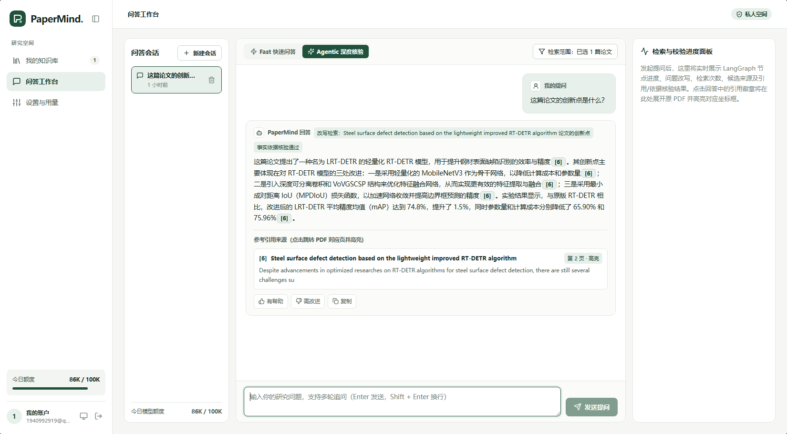
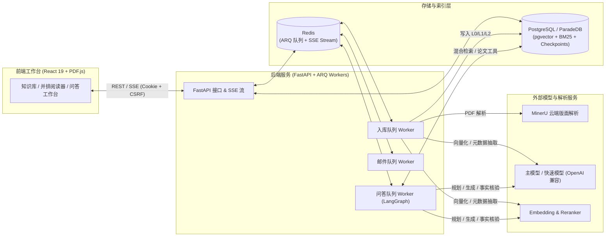

<div align="center">

# 📚 PaperMind

**面向科研阅读与学术问答的论文知识库系统**

上传 PDF，自动完成版面解析、多粒度分块与混合检索索引。  
结合三层论文地图、阅读工具与 LangGraph 深度核验工作流，将每一句回答精准定位回原始 PDF 坐标。

[](https://www.python.org/)
[](https://fastapi.tiangolo.com/)
[](https://react.dev/)
[](https://www.typescriptlang.org/)
[](https://www.langchain.com/langgraph)
[](https://www.paradedb.com/)
[](https://docs.docker.com/compose/)

[核心特性](#-核心特性) • [界面预览](#-界面预览) • [系统架构](#-系统架构与工作流) • [快速开始](#-快速开始) • [配置说明](#️-配置说明) • [开发与测试](#-开发与测试) • [项目文档](#-项目结构与文档)

</div>

---

## 🖼️ 界面预览

<div align="center">
  
  <p><em>PaperMind 科研问答工作台：支持 Fast / Agentic 双模式切换、多轮追问、引用原文悬停预览、点击跳转 PDF 坐标高亮，以及右侧实时检索与校验进度面板。</em></p>
</div>

---

## ✨ 核心特性

- 🗂️ **多用户私人论文库**
  - 支持邮箱验证码注册与找回密码、多知识库分组管理、PDF 拖拽上传与版本原子切换。
  - 自动融合 PDF 属性、MinerU 解析原文、Crossref / arXiv 接口与快速模型，完成论文元数据（标题、作者、年份、场刊、DOI、摘要）提取与在线编辑。
  - 支持失败重试、复用解析结果的低成本**重新分块（Rechunk）**，以及重新云端解析（Reparse）。

- 📖 **PDF 与结构化正文并排精读**
  - 左侧支持切换**解析 Markdown 视图**（支持 GFM 表格、KaTeX 公式、同源授权图片渲染与严格 XSS 清洗）与**分块检查器（Chunk Inspector）**。
  - 右侧内嵌原始 PDF 阅读器，支持点击任意分块或引用徽章自动翻页，并在页内绘制归一化 `bbox` 坐标高亮框。

- 🧠 **三层论文地图（L0 / L1 / L2）与原生阅读工具**
  - **L0 论文地图**：挂载论文标题、完整摘要、两级目录树及全量图表（Table / Figure）Caption 索引，辅助全局导航。
  - **L1 章节全文**：按原生学术章节（`method`、`experiments`、`ablation`、`limitations` 等）保留完整父块上下文。
  - **L2 多模态分块**：结合带上下文头的段落块、保留完整 Markdown / HTML 结构的表格块（附带趋势与极值摘要）及上下文关联公式块。
  - **三大阅读工具**：模型按需原生调用 `search_paper_chunks`（多探针并行混合检索）、`read_paper_section`（整节无损调阅）与 `inspect_element`（按 `Table 2` / `Equation (4)` 精确调阅图表公式及正文引用分析）。

- 🔬 **Fast / Agentic 双模式科研问答**
  - **Fast 快速问答**：记忆加载 → 问题改写 → 混合检索与工具调用 → 流式生成 → 引用规则校验。
  - **Agentic 深度核验**：在 Fast 基础上增加**候选来源相关性评分**、**检索纠错改写**与**LLM 事实依据核验（Verify Grounding）**；未通过校验时自动触发有界重生成，确保每句结论均有据可查。
  - **断点续读 SSE**：基于 PostgreSQL 事件表与 Redis Stream 双写镜像，支持网络断线或刷新页面后通过 `Last-Event-ID` 无缝恢复流式输出与实时节点时间线。

- 🛡️ **租户隔离、配额预算与管理控制台**
  - 检索 SQL 通道在 Top-K 召回前强制校验用户归属与活跃版本，杜绝跨租户数据泄漏。
  - 内置原子预占与按节点（Embedding、Rerank、改写、生成、核验、摘要）精细化结算的每日页数 / Token 预算控制。
  - 提供个人回答偏好设置（语言 / 详略）、分节点用量统计面板，以及管理员专属的全局监控、用户启停、配额覆盖与评测报告控制台。

---

## 🏗️ 系统架构与工作流



---

## 🛠️ 技术栈

| 层级 | 核心技术与组件 |
| :--- | :--- |
| **前端工作台** | React 19、TypeScript、Vite、Tailwind CSS、React PDF (`pdf.js`)、`react-markdown`、KaTeX |
| **后端 API** | Python 3.12、FastAPI、SQLAlchemy 2.0 (Async)、Alembic、Pydantic v2 |
| **问答编排** | LangGraph、LangChain、原生 Function Calling、PostgreSQL Checkpointer、可续读 SSE |
| **存储与检索** | PostgreSQL 16 (ParadeDB)、`pgvector` 稠密向量检索、`pg_search` BM25 稀疏检索、动态加权 RRF 融合 + Rerank |
| **异步任务** | Redis 7、ARQ 异步队列（独立隔离 `mail` / `ingest` / `chat` 队列）+ Transactional Outbox |
| **外部服务** | MinerU VLM 云解析、OpenAI 兼容 LLM（如 DeepSeek / Qwen）、Embedding (`bge-m3`)、Reranker (`bge-reranker-v2-m3`)、SMTP、Langfuse |
| **部署与基建** | Docker Compose、Nginx（同源反向代理与安全 CSP 响应头） |

---

## 🚀 快速开始

### 1. 环境要求

- **Docker** 与 **Docker Compose** `2.24+`
- **Python** `3.12` 与 [**uv**](https://docs.astral.sh/uv/)
- **Node.js** `20.19+`（或 `22+`）与 **npm**
- 可用的外部服务凭据：OpenAI 兼容模型 API、Embedding & Rerank 服务、MinerU Token、SMTP 邮箱配置（以及可选的 Langfuse 追踪密钥）

### 2. 安装与一键启动

```bash
git clone https://github.com/gxiaopang/PaperMind.git
cd PaperMind

# 1. 首次使用时复制配置模板（若已有 .env 请保留）
test -f .env || cp deploy/.env.example .env
```

编辑根目录下的 `.env`，填入模型服务、MinerU 和 SMTP 等必要凭据，随后执行：

```bash
# 2. 安装前后端依赖，并自动生成 .env.local（包含随机数据库密码、Fernet 邮件加密密钥与本地连接串）
make bootstrap

# 3. 构建镜像并启动 PostgreSQL、Redis、数据库自动迁移、API、Worker 和 Web 服务
make up
```

启动完成后，即可通过浏览器访问以下入口：

| 服务入口 | 访问地址 | 说明 |
| :--- | :--- | :--- |
| **Web 工作台** | http://localhost:8080 | 注册并验证邮箱后，即可创建知识库、上传 PDF 与发起问答 |
| **API 交互文档** | http://localhost:18000/docs | FastAPI OpenAPI / Swagger 调试界面 |
| **服务就绪检查** | http://localhost:18000/readyz | 检查数据库、Redis 与核心依赖连通状态 |

常用运维指令：

```bash
make logs     # 实时查看 API / Worker / Web 容器日志
make down     # 停止容器服务（保留数据库与论文文件持久卷）
```

> [!NOTE]
> 上传论文进行解析时会将 PDF 发送至 MinerU 云服务；解析、向量化、重排序与多轮问答均会消耗对应外部服务额度。

---

## ⚙️ 配置说明

完整环境变量模板参见 [`deploy/.env.example`](deploy/.env.example)。系统按以下优先级依次加载并覆盖配置（进程环境变量优先级最高）：

```text
.env  ──►  .env.local (由 make bootstrap 自动生成管理)  ──►  .env.smtp.local (可选独立邮件凭据)
```

| 配置分组 | 关键变量 | 说明 |
| :--- | :--- | :--- |
| **主模型 / 快速模型** | `LLM_BASE_URL`, `LLM_API_KEY`, `LLM_MODEL`<br>`LLM_FAST_BASE_URL`, `LLM_FAST_API_KEY`, `LLM_FAST_MODEL` | 主模型负责规划、生成与核验；快速模型负责路由、改写、评分、摘要及元数据/表格摘要抽取 |
| **向量与重排** | `EMBEDDING_BASE_URL`, `EMBEDDING_MODEL`, `EMBEDDING_DIM`<br>`RERANK_BASE_URL`, `RERANK_MODEL` | 推荐使用 `BAAI/bge-m3` (1024 维) 与 `BAAI/bge-reranker-v2-m3` |
| **MinerU 解析** | `MINERU_API_BASE`, `MINERU_API_TOKEN`, `MINERU_MODEL_VERSION` | 云端 PDF 解析凭据，默认开启公式与表格识别（`vlm` 模式） |
| **邮件服务** | `SMTP_HOST`, `SMTP_PORT`, `SMTP_USERNAME`, `SMTP_PASSWORD`, `MAIL_FROM` | 用于发送 6 位注册验证码与密码重置邮件；可单独存放在 `.env.smtp.local` |
| **可观测性** | `TRACING_ENABLED`, `LANGFUSE_BASE_URL`, `LANGFUSE_PUBLIC_KEY`, `LANGFUSE_SECRET_KEY` | 默认开启节点追踪且不采集原文内容；无需追踪时可设 `TRACING_ENABLED=false` |
| **配额与并发** | `USER_DAILY_PARSE_PAGES`, `USER_DAILY_MODEL_TOKENS`, `PROVIDER_CONCURRENCY` | 单用户每日解析页数、每日模型 Token 预算及跨进程供应商并发上限 |

> [!CAUTION]
> 请勿将包含真实密钥的 `.env*`、本地论文数据（`data/`）或私有解析产物提交至 Git 仓库。

---

## 💻 开发与测试

### 本机热重载调试

若需在宿主机直接调试前后端代码，可仅通过 Docker 启动基础设施（PostgreSQL 与 Redis）：

```bash
make bootstrap
make infra        # 仅启动 PostgreSQL (15432) 与 Redis (16379)
make migrate      # 执行 Alembic 数据库迁移与 LangGraph Checkpoints 初始化

# 在三个终端分别启动服务（Vite 会自动将 /api 代理至本机 18000 端口）：
make api
make worker
make web
```

### 管理员命令行工具

```bash
# 在 backend/ 目录下执行（或通过 docker compose exec api python -m app.cli ...）：
cd backend
uv run python -m app.cli admin someone@example.com      # 授予管理员权限
uv run python -m app.cli disable someone@example.com    # 停用账户并立即吊销其活跃会话
uv run python -m app.cli enable someone@example.com     # 重新启用账户
```

### 质量检查与自动化测试

普通测试均使用内存替身或独立容器（`testcontainers`），**不会调用付费模型、MinerU 或发送真实邮件**：

```bash
make check            # 代码质量检查：ruff lint/format、mypy 类型检查、前端 eslint 与生产构建
make test             # 运行完整后端测试套件（含独立 PostgreSQL / Redis 集成测试）
make test-parsing     # 运行 MinerU 解析与容错离线测试
make test-ingestion   # 运行分块、批量向量化与入库测试
make test-retrieval   # 运行混合检索、论文工具、租户隔离与降级测试
make test-chat        # 运行 LangGraph 问答图、记忆摘要、SSE 续读与幂等测试
make e2e              # 启动真实后端与独立数据库，运行 Playwright Chromium 端到端测试
```

如需显式验证外部供应商连通性或运行实模评测（会消耗少量 API 额度）：

```bash
make smoke            # 校验 LLM、Embedding、Rerank、MinerU、SMTP 与 Langfuse 连通性
make eval-retrieval   # 运行 M3 检索黄金集四种消融方案评测
make smoke-chat       # 运行 M4 真实模型工具问答冒烟测试
```

---

## 📂 项目结构与文档

```text
PaperMind/
├── backend/       # FastAPI 应用、LangGraph 问答编排、混合检索、ARQ 异步任务、Alembic 迁移与后端测试
├── frontend/      # React 19 + TypeScript 前端工作台、并排 PDF 阅读器与 Playwright E2E 测试
├── deploy/        # Dockerfile、Docker Compose 编排、Nginx 安全配置与环境变量模板
├── scripts/       # 环境初始化 (bootstrap)、镜像拉取辅助、E2E 启动器与评测脚本
├── eval/          # 检索评测数据集 (v7)、冻结语料与人工审核记录
├── docs/          # 架构设计、阶段开发说明与验收记录
├── reports/       # 脱敏的自动化验证与检索评测报告
└── images/        # 项目界面预览截图
```
